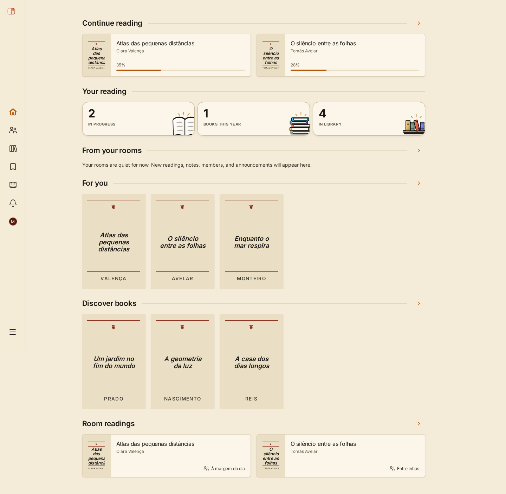

# TowelBooks UI Showcase

[**Live demo**](https://towelbooks-ui-showcase.pages.dev) · [**CI**](https://github.com/Alsogravity/towelbooks-ui-showcase/actions/workflows/ci.yml)

An interactive portfolio of a reading-first product interface: book discovery, personal libraries, reading progress, collections, and reading rooms.

**Fictional demo data. No account, backend, or credentials required.** Changes stay in memory and reset on reload. The showcase preserves the TowelBooks paper-and-ink palette, typography, custom illustrations, themes, and responsive navigation.



## Explore

| Experience                   | Route               | Interactions                                                              |
| ---------------------------- | ------------------- | ------------------------------------------------------------------------- |
| Original landing composition | `/`                 | Illustrated product presentation, language selection, portfolio notice    |
| Product home                 | `/demo`             | Continue reading, reading summary, discovery, rooms                       |
| Catalog                      | `/demo/catalog`     | Accent-insensitive search, category filters, book details, add to library |
| Personal library             | `/demo/library`     | Reading progress, local notes, reading editor, removal                    |
| Collections                  | `/demo/collections` | Curated book shelves and collection details                               |
| Reading rooms                | `/demo/rooms`       | Room details, join/leave, local discussion replies                        |
| Reader profile               | `/demo/profile`     | Fictional reader identity and connected library                           |
| Preferences                  | `/demo/settings`    | Light/dark themes and pt-BR/en-US interface                               |
| UI states                    | `/demo/states`      | Content, loading, empty, error, and retry presentations                   |
| Access preview               | `/preview/auth`     | Credential-free entry into the demo                                       |
| Pricing concepts             | `/pricing`          | Original Free example and blurred unreleased Plus concept                 |

Use **Reset demo** to restore library data, room membership, and discussion replies. Theme and language preferences apply to the current visit. Book names and community content intentionally stay in their original language when the interface language changes.

## Run locally

Requires Node.js 24 (or >=22.22.1) and pnpm 10.30.1.

```sh
pnpm install --frozen-lockfile
pnpm dev
```

Open [localhost:3055](http://127.0.0.1:3055). No `.env` file, API server, Docker, database, or cloud credentials are needed.

```sh
pnpm build
pnpm preview
```

For a production preview that also enforces the deployment security headers, run `node scripts/serve.mjs` and open [localhost:3056](http://127.0.0.1:3056).

## Design and implementation

TowelBooks is a project for discovering books, keeping a personal reading library, and reading together in small communities. This repository presents its visual and frontend work as an independent, curated portfolio.

The reading-room identity uses warm paper, dark ink, brick and forest accents, restrained dividers, literary illustration, and semantic typography. Lists, bookshelves, and editorial sections carry the hierarchy; bounded cards represent books, rooms, and compact summaries. The mobile layout keeps core reading destinations in a bottom navigation bar, while desktop uses a collapsible sidebar.

The UI and design-token packages, original landing composition, illustrations, typographic covers, and layout primitives are extracted sources. Demo containers, local workflows, and the shell are adaptations. This is a curated showcase rather than a claim of complete production workflow parity. [SOURCE.md](SOURCE.md) records the original commit; [architecture](docs/architecture.md) explains the boundaries and omitted service-dependent workflows.

```text
apps/showcase   routes, presentation, fictional data, and local interactions
packages/ui     shared router-independent primitives and icons
packages/design-tokens   original brand tokens and typography
```

The main interactions use accessible labels, native controls, keyboard navigation, dialog focus management, and focus restoration. Reduced-motion preferences are respected. Both themes and both interface languages are available without persistence or tracking.

## Validation

```sh
pnpm format:check
pnpm lint
pnpm typecheck
pnpm test
pnpm security:audit
pnpm build
pnpm exec playwright install chromium
pnpm test:browser
```

Browser checks cover route refreshes, search/filter recovery, reading edits and reset across pages, room membership and replies, locale/theme selection, keyboard dialog dismissal, horizontal overflow after font loading, collection cover containment, broken loaded images, console errors, and absence of application service requests. They run at desktop and mobile sizes against production assets with the static CSP applied.

## Deployment

Static output is `apps/showcase/dist`. The live site uses a separate Cloudflare Pages Direct Upload project, with no API keys in the application. GitHub pushes run validation; deployment is a separate manual command. See [deployment and live verification](docs/deployment.md).

## Rights and attribution

Project source, original design, and original artwork are **all rights reserved**; see [LICENSE](LICENSE). Public source visibility is for portfolio inspection. Third-party dependencies and fonts retain their own licenses. See [third-party notices](THIRD-PARTY-NOTICES.md) and [asset provenance](docs/assets.md).
