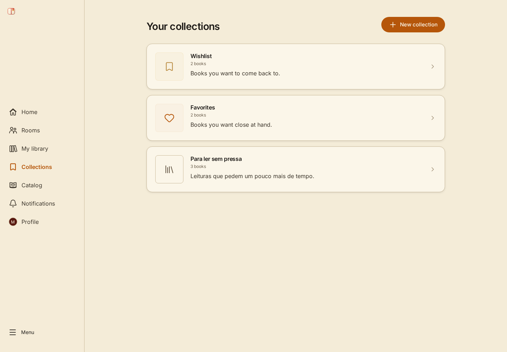

# TowelBooks UI Showcase

[**Live demo**](https://towelbooks-ui-showcase.pages.dev/demo) · [**CI**](https://github.com/Alsogravity/towelbooks-ui-showcase/actions/workflows/ci.yml)

The original TowelBooks frontend, extracted into an independent portfolio repository. Its pages, layouts, components, styles, translations, icons, and responsive behavior are copied directly from the product source.

**Fictional data. No account, backend, database, or credentials required.** Demo changes stay in memory and reset when the page reloads. Open `/demo` directly, or use the original landing page's sign-in links to enter the demo.



## Explore

- Original landing and pricing pages: `/` and `/pricing`.
- Original product shell and dashboard: `/demo`.
- Catalog, collections, reading rooms, and fictional reader profile through the original navigation.
- Personal library, book details, reading sessions, and local notes.
- Original settings overlay, themes, and English/Portuguese interface.

Account lifecycle, payments, email, real uploads, analytics, and administrative services are unavailable. Those operations cannot reach production services. Some advanced community workflows show original empty states or an unavailable-operation error; this is a UI portfolio, not a hosted reading service.

## Run locally

Requires Node.js 24 (or >=22.22.1) and pnpm 10.30.1.

```sh
pnpm install --frozen-lockfile
pnpm dev
```

Open [localhost:3055](http://127.0.0.1:3055/demo). No `.env`, Docker, API server, or cloud login is needed.

```sh
pnpm build
node scripts/serve.mjs
```

The production preview runs at [localhost:3056](http://127.0.0.1:3056/demo), including the static security headers.

## Extraction boundaries

The extraction includes the original `apps/web/src`, UI, design tokens, schemas, and SDK. Of 1,108 extracted source files, **1,102 remain byte-for-byte identical**. Only six integration files adapt authentication entry, SDK transport, app startup, route basename, and site metadata. New demo code lives under `apps/showcase/src/demo`; it supplies the original SDK with an in-memory fetch transport.

`pnpm source:check` verifies these boundaries against the original commit's hashes. [SOURCE.md](SOURCE.md) records provenance and [architecture](docs/architecture.md) explains the six adaptations. This repository runs independently of the original checkout.

```text
apps/showcase             original frontend + isolated demo adapter
packages/ui               original shared components and icons
packages/design-tokens    original design tokens and typography
packages/schemas          original API validation contracts
packages/sdk              original client with injected local transport
```

## Validation

```sh
pnpm source:check
pnpm format:check
pnpm lint
pnpm typecheck
pnpm test
pnpm security:audit
pnpm build
pnpm exec playwright install chromium
pnpm test:browser
```

Contract tests exercise the original SDK against the demo adapter. Browser checks run the original pages and forms at desktop/mobile sizes with deployment CSP applied, and reject service traffic, console errors, and horizontal overflow. Source fidelity is also checked in CI.

## Deployment and rights

Static output is `apps/showcase/dist`. The existing Cloudflare Pages project uses Direct Upload; pushes run CI and deployment is a separate command. See [deployment](docs/deployment.md).

Original project source, design, and artwork remain **all rights reserved** under [LICENSE](LICENSE), except separately licensed files/packages and third-party assets. Public visibility permits portfolio inspection and does not grant a general reuse license. Third-party dependencies, the schemas package's original MIT declaration, and fonts retain their licenses. See [notices](THIRD-PARTY-NOTICES.md) and [asset provenance](docs/assets.md).
